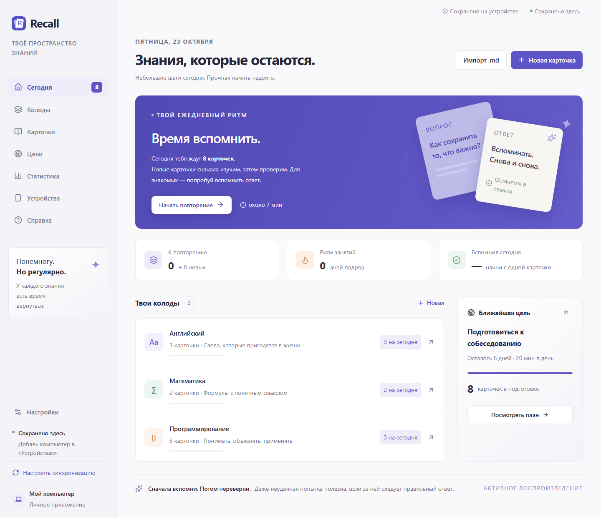

# Recall

[English](#english) · **[Русский](#russian)**

## English

Flashcards for long-term memory and studying toward a deadline. Learn on your computer and phone, review on schedule, and track your progress. The app interface is currently in Russian.

**[Download for Windows](https://github.com/MantyZOR/Recall/releases/latest)** · **[Open the web app](https://mantyzor.github.io/Recall/)**

### Quick start

1. Download **Recall-portable-win-x64.zip** and extract the entire archive.
2. Open **Recall.exe** → **Открыть на ПК** (Open on PC).
3. To connect your phone, choose **Подключить телефон** (Connect phone) and follow the QR instructions. Both devices must be on the same local network.

After setup, your phone works without the computer or internet. Add each PC or laptop once, then use **Синхронизировать сейчас** (Sync now) when they share a local network. [Multi-device setup](docs/local-sync.md). The Windows download includes Node.js.

**Platforms:** Windows 10/11 x64. Tested on iPhone; Android still needs testing on a real device.

The **web app** needs internet on its first visit and works offline afterward. For ongoing sync, connect it to a computer running the Recall service.

### Features

- Question/answer, typed answers, cloze deletions, and shuffled single- or multiple-choice questions. Images, formulas, and code highlighting.
- FSRS-7 spaced repetition, deadline goals, and extra practice.
- Markdown/ZIP import, statistics, backups, and offline study.

### Help & development

The detailed guides are currently in Russian:

[Phone setup](docs/connection-guide.md) · [How Recall works](docs/mini-wiki.md) · [Import format](docs/markdown-format.md) · [Full guide](docs/reference.md)

[Build from source](docs/github-and-portability.md) · **[Release commands](docs/releasing.md)**

---

## Русский

Карточки для запоминания надолго и подготовки к дате. Учись на компьютере и телефоне, повторяй материал по расписанию и отслеживай прогресс.

**[Скачать приложение для Windows](https://github.com/MantyZOR/Recall/releases/latest)**

### Быстрый запуск

1. Скачай **Recall-portable-win-x64.zip** и распакуй весь архив.
2. Открой **Recall.exe** → **Открыть на ПК**.
3. Для телефона выбери **Подключить телефон** и следуй инструкции по QR. ПК и телефон должны быть в одной сети.

После первого подключения телефон работает без компьютера и интернета. ПК и ноутбук добавляются один раз; дальше используй **«Синхронизировать сейчас»** в общей сети. [ПК + ноутбук + телефон](docs/local-sync.md). Устанавливать Node.js отдельно для готовой сборки не требуется.

Сборка: Windows 10/11 x64. Работа на iPhone проверена; Android ещё требует проверки на настоящем устройстве.

**Веб-версия:** [открыть Recall](https://mantyzor.github.io/Recall/). Для постоянной синхронизации добавь компьютер с работающей службой Recall. Первый запуск страницы требует интернета.

### Возможности

- Вопрос/ответ, ввод, пропуски и выбор одного или нескольких ответов с перемешиванием. Изображения, формулы и код.
- Повторение по FSRS-7, цели к нужной дате и дополнительная практика.
- Импорт Markdown/ZIP, статистика, резервные копии и работа без сети.

### Помощь

- [Подключение телефона](docs/connection-guide.md)
- [Как работает Recall](docs/mini-wiki.md)
- [Формат импорта карточек](docs/markdown-format.md)
- [Подробное руководство](docs/reference.md)

### Разработка

[Исходники и сборка](docs/github-and-portability.md) · **[Как самому выпустить релиз — команды](docs/releasing.md)**
