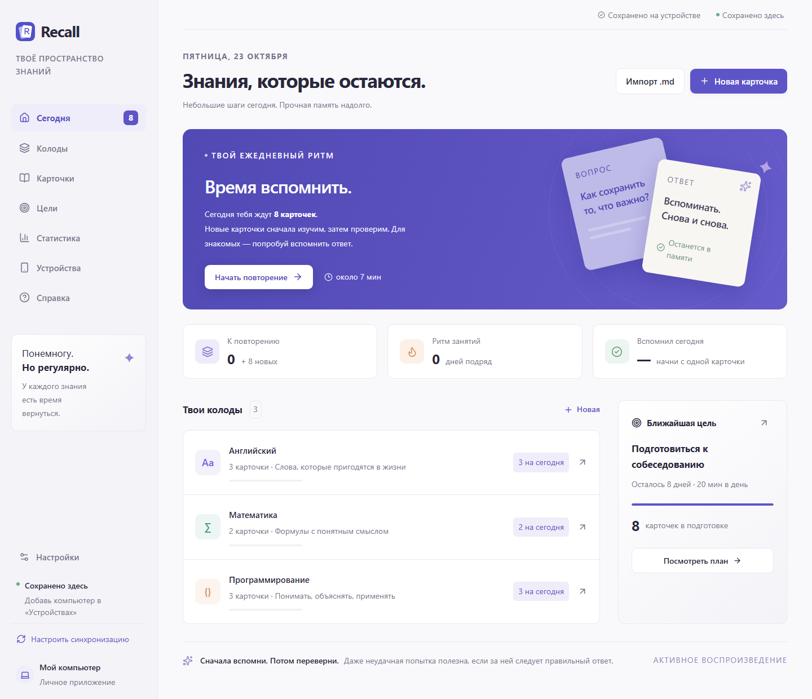

# Recall

[English](#english) · **[Русский](#russian)**

## English

Flashcards for long-term memory and studying toward a deadline. Learn on your computer and phone, review on schedule, and track your progress. The app interface is currently in Russian.

**[Download for Windows](https://github.com/MantyZOR/Recall/releases/latest)** · **[Open the web app](https://mantyzor.github.io/Recall/)**

### Quick start

1. Download **RecallSetup.exe**, run it and choose where to install Recall.
2. Use the **Recall** desktop shortcut or Start menu, then click **Открыть на ПК** (Open on PC).
3. To connect a phone on the same network, create a code under **Устройства** (Devices) on the PC and enter it once on the phone.

After setup, your phone works offline. Add each computer once; Recall can find it after its IP changes. Sync works on the local network and does not use a cloud server. [Install, migrate and update](docs/windows-install.md) · [Multi-device setup](docs/local-sync.md).

**Platforms:** Windows 10/11 x64. Tested on iPhone; Android still needs testing on a real device.

The **web app** needs internet on its first visit and works offline afterward. For ongoing sync, connect it to a computer running the Recall service.

### Features

- Question/answer, typed answers, cloze deletions, and shuffled single- or multiple-choice questions. Images, formulas, and code highlighting.
- FSRS-7 spaced repetition, deadline goals, and extra practice.
- Markdown/ZIP import, statistics, backups, and offline study.

### Help & development

The detailed guides are currently in Russian:

[Phone setup](docs/connection-guide.md) · [How Recall works](docs/mini-wiki.md) · [Import format](docs/markdown-format.md) · [Full guide](docs/reference.md)

[Build from source](docs/github-and-portability.md) · **[Release commands](docs/releasing.md)**

---

## Русский

Карточки для запоминания надолго и подготовки к дате. Учись на компьютере и телефоне, повторяй материал по расписанию и отслеживай прогресс.

**[Скачать приложение для Windows](https://github.com/MantyZOR/Recall/releases/latest)**

### Быстрый запуск

1. Скачай **RecallSetup.exe**, запусти его и выбери папку установки.
2. Открой **Recall** с рабочего стола или из меню «Пуск» и нажми **Открыть на ПК**.
3. Для телефона в той же сети создай код в **Устройствах** на ПК и введи его один раз на телефоне.

После первого подключения телефон работает офлайн. ПК и ноутбук добавляются один раз, Recall находит их и после смены IP. Синхронизация идёт в общей сети, без облака. [Установка, перенос и обновление](docs/windows-install.md) · [ПК + ноутбук + телефон](docs/local-sync.md).

Сборка: Windows 10/11 x64. Работа на iPhone проверена; Android ещё требует проверки на настоящем устройстве.

**Веб-версия:** [открыть Recall](https://mantyzor.github.io/Recall/). Для постоянной синхронизации добавь компьютер с работающей службой Recall. Первый запуск страницы требует интернета.

### Возможности

- Вопрос/ответ, ввод, пропуски и выбор одного или нескольких ответов с перемешиванием. Изображения, формулы и код.
- Повторение по FSRS-7, цели к нужной дате и дополнительная практика.
- Импорт Markdown/ZIP, статистика, резервные копии и работа без сети.

### Помощь

- [Подключение телефона](docs/connection-guide.md)
- [Как работает Recall](docs/mini-wiki.md)
- [Формат импорта карточек](docs/markdown-format.md)
- [Подробное руководство](docs/reference.md)

### Разработка

[Исходники и сборка](docs/github-and-portability.md) · **[Как самому выпустить релиз — команды](docs/releasing.md)**
